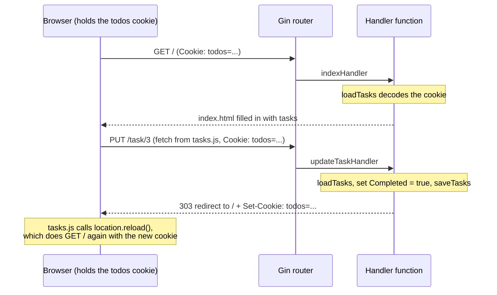

# How main.go Works

This document walks through [main.go](main.go): how it starts a web server, answers requests, and connects to the HTML in [templates/](templates/) and the JavaScript in [static/js/](static/js/). It assumes you can read a little Go but have never used Gin.

## What is Gin?

[Gin](https://gin-gonic.com/) is a web framework for Go. Go's standard library can already run a web server (the `net/http` package), and Gin is a layer on top of it that makes the common jobs shorter:

- **Routing:** "when a `PUT` request arrives for `/task/3`, call this function", with `3` pulled out of the URL for you.
- **A context object:** every handler function receives a `*gin.Context` (written `c` by convention). It holds the incoming request and has helpers for reading form fields and sending responses.
- **Middleware:** functions that run around every request, such as logging or crash recovery.
- **HTML rendering:** fill in a template with data and send it as the response.

Everything in this app could be written with plain `net/http`. Gin just removes the boilerplate.

## The big picture

The server renders full HTML pages. There is no separate frontend app and no JSON API. The browser either submits a normal form or makes a small `fetch` call, then reloads the page to see the result.

The server keeps **no state**. Each visitor's task list lives in a cookie in their own browser, which is sent along with every request. The handler reads the list from the cookie, changes it, and sends the updated list back in a `Set-Cookie` header.



## Startup: `main()`

### 1. Choosing the address

```go
addrPtr := flag.String("addr", ":8080", "HTTP network address")
flag.Parse()

addr := *addrPtr

if envPort := os.Getenv("PORT"); envPort != "" {
    addr = "0.0.0.0:" + envPort
}
```

By default the server listens on port 8080. You can override that with `-addr :9000` on the command line. If the `PORT` environment variable is set, it wins. Hosting platforms such as Vercel tell your app which port to use through `PORT`.

### 2. Creating the router and middleware

```go
router := gin.New()
router.Use(gin.Recovery())
```

`gin.New()` creates an empty router. `router.Use(...)` adds middleware that runs on every request. `gin.Recovery()` catches a panic (Go's equivalent of an uncaught exception) inside a handler and turns it into a `500 Internal Server Error`, instead of letting it crash the whole server.

You may see `gin.Default()` in Gin tutorials. It is `gin.New()` plus `Recovery` plus a request logger. This app leaves the logger out, so it does not print a line per request. When it starts, Gin prints `[GIN-debug]` lines listing every route. Set `GIN_MODE=release` to silence them.

### 3. Embedding the templates and static files

```go
var (
    //go:embed templates/*.html
    templatesFS embed.FS

    //go:embed static
    staticFS embed.FS
)
```

The `//go:embed` comments are instructions to the Go compiler: "copy these files into the program". At runtime, `templatesFS` and `staticFS` behave like read-only folders, but they live inside the binary. That is why the compiled program runs from any directory, or on a server where the `templates/` folder doesn't exist on disk.

They are then handed to Gin:

```go
staticSub, err := fs.Sub(staticFS, "static")
...
router.SetHTMLTemplate(template.Must(template.ParseFS(templatesFS, "templates/*.html")))
router.StaticFS("/static", http.FS(staticSub))
```

- `template.ParseFS` reads every `templates/*.html` file and parses it as a Go template. Each one is registered under its file name (`index.html`, `task.html`, `error.html`). `template.Must` stops the program at startup if a template has a syntax error, so a broken template never reaches users.
- `SetHTMLTemplate` tells Gin to use those templates whenever a handler calls `c.HTML(...)`.
- `fs.Sub(staticFS, "static")` drops the leading `static/` folder name. `StaticFS("/static", ...)` then serves those files as-is, so a request for `/static/js/main.js` returns the embedded file `static/js/main.js`.

### 4. The routes

```go
router.GET("/", indexHandler)
router.POST("/task", createTaskHandler)
router.GET("/task/:id", getTaskHandler)
router.PUT("/task/:id", updateTaskHandler)
router.DELETE("/task/:id", deleteTaskHandler)
router.PUT("/task/:id/title", updateTaskTitleHandler)
```

Each line connects an HTTP method and a URL pattern to a function. `:id` is a **path parameter**: it matches any single segment (`/task/3`, `/task/abc`), and the handler reads it with `c.Param("id")`.

| Method | Path | Handler | Called by | Response |
| --- | --- | --- | --- | --- |
| GET | `/` | `indexHandler` | Browser opening the page | `index.html` with all tasks |
| POST | `/task` | `createTaskHandler` | The "Add Task" form | 303 redirect to `/` |
| GET | `/task/:id` | `getTaskHandler` | Visiting e.g. `/task/3` directly | `task.html` for one task |
| PUT | `/task/:id` | `updateTaskHandler` | Check / undo button (`tasks.js`) | 303 redirect to `/` |
| PUT | `/task/:id/title` | `updateTaskTitleHandler` | Edit save button or Enter (`tasks.js`) | 303 redirect to `/` |
| DELETE | `/task/:id` | `deleteTaskHandler` | Trash button (`tasks.js`) | 303 redirect to `/` |
| GET | `/static/*` | built in (`StaticFS`) | `<script>` tags | The JS file |

When something goes wrong, the handlers send `error.html` instead: 400 for a bad ID, an empty title, or a list too big to fit in the cookie; 404 for an unknown task.

### 5. Starting the server

```go
if err := router.Run(addr); err != nil {
    log.Fatal(err)
}
```

`router.Run` starts listening and blocks forever, serving requests. It only returns if something fails, for example if the port is already in use.

## Where the tasks live: a cookie

```go
type Task struct {
    ID        int    `json:"id"`
    Title     string `json:"title"`
    Completed bool   `json:"completed"`
}

type taskList struct {
    NextID int    `json:"next"`
    Tasks  []Task `json:"tasks"`
}
```

There is no database, and nothing is stored on the server. A `taskList` holds one visitor's tasks (in a slice, Go's growable array) plus `NextID`, the ID the next new task gets. The `json:"..."` tags set the field names when the list is turned into JSON.

**Why not just keep the tasks in a variable on the server?** The first version did exactly that, and it worked locally. On Vercel it broke in a confusing way: Vercel runs several copies of the app at once, starting more when traffic arrives and stopping idle ones. Each copy had its own separate list in memory, so refreshing the page showed a different list depending on which copy answered. Keeping the list in the visitor's browser means it doesn't matter which copy handles the request. As a bonus, every visitor gets a private list.

Two helpers move the list in and out of the cookie:

- **`loadTasks(c)`** reads the `todos` cookie with `c.Cookie`, base64-decodes it, and parses the JSON. A missing or garbled cookie just gives an empty list, so a visitor can never break the page by editing their cookie.
- **`saveTasks(c, tl)`** does the reverse: JSON, then base64 (cookie values can't contain the quotes and commas JSON uses), then a `Set-Cookie` header. The cookie is:
  - `HttpOnly`: page JavaScript can't read it. Only the browser and server see it.
  - `SameSite=Lax`: other websites can't make the browser send it along with their own requests.
  - `Secure` when served over HTTPS, as on Vercel.
  - Kept for one year (`MaxAge`).

Browsers cap a cookie at about 4 KB, so `saveTasks` refuses a list whose encoded form is over 3,800 bytes and shows "Your list is full" instead. That's roughly 25 to 50 tasks, depending on title length. It returns `false` in that case, so the handler knows not to redirect.

Because each request carries its own list, handlers never share data, and the code needs no locks.

## The handlers

Every handler has the same signature, `func(c *gin.Context)`. These are the `Context` methods the app uses:

| Method | What it does |
| --- | --- |
| `c.Param("id")` | Reads the `:id` part of the URL, as a string |
| `c.PostForm("title")` | Reads a field from a form-encoded request body |
| `c.HTML(status, "name.html", data)` | Renders a template with `data` and sends it |
| `c.Redirect(http.StatusSeeOther, "/")` | Sends a 303 telling the browser to go to `/` |

Alongside `loadTasks` and `saveTasks`, three small helpers keep the handlers short:

- **`parseID(c)`** converts `:id` to an `int` with `strconv.Atoi`. If that fails (`/task/abc`), it sends a 400 error page and returns `ok == false`, and the handler just returns.
- **`findTask(tasks, id)`** returns the slice index of the task with that ID, or `-1`.
- **`renderError(c, status, message)`** renders `error.html` with a message.

The handlers then follow one pattern: parse the input, load the list, find the task, change it, save the list, redirect. For example:

```go
func updateTaskHandler(c *gin.Context) {
    id, ok := parseID(c)
    if !ok {
        return
    }

    completed := c.PostForm("completed") == "true"

    tl := loadTasks(c)
    i := findTask(tl.Tasks, id)
    if i < 0 {
        renderError(c, http.StatusNotFound, "Task not found")
        return
    }
    tl.Tasks[i].Completed = completed
    if saveTasks(c, tl) {
        c.Redirect(http.StatusSeeOther, "/")
    }
}
```

`createTaskHandler` has one extra step. Before appending, it makes sure `NextID` is higher than every existing ID, because a visitor could hand-edit their cookie and cause duplicate IDs.

**Why redirect instead of returning a page?** This is the *Post/Redirect/Get* pattern. After a change, the server says "now go and GET `/`" (303 See Other). The browser ends up on a normal page load, so pressing refresh never resubmits the change.

## Templates: from `c.HTML` to the page

`indexHandler` is the whole bridge between Go and HTML:

```go
c.HTML(http.StatusOK, "index.html", gin.H{
    "tasks": loadTasks(c).Tasks,
})
```

`gin.H` is just a shorthand for `map[string]any`, a dictionary of values. Gin looks up the template named `index.html` (registered at startup) and runs it with that map as its data. Inside the template, `.` means "the data". So `.tasks` is the slice of tasks.

The relevant part of [templates/index.html](templates/index.html):

```html
{{range .tasks}}
<li class="list-group-item ...">
    {{if .Completed}}
    <i class="bi bi-check-circle-fill text-success"></i>
    {{else}}
    <i class="bi bi-circle text-secondary"></i>
    {{end}}
    <span class="ms-2" {{if .Completed}} style="text-decoration: line-through;" {{end}}>{{.Title}}</span>
    ...
    <button class="... toggle-complete-button"
            data-task-id="{{.ID}}" data-completed="{{.Completed}}">
    ...
</li>
{{end}}
```

- `{{range .tasks}} ... {{end}}` repeats the block once per task. Inside the loop, `.` is now the current `Task`, so `.Title`, `.ID` and `.Completed` are its fields.
- `{{if .Completed}} ... {{else}} ... {{end}}` chooses the icon and adds the strikethrough.
- `{{.Title}}` prints the title. Go's `html/template` **escapes it automatically**, so a task titled `<script>` shows up as text and can't run as code.
- `data-task-id="{{.ID}}"` and `data-completed="{{.Completed}}"` don't change how the page looks. They exist so the JavaScript knows which task a button belongs to. This is the handoff from server to browser.

The other two templates:

- [templates/task.html](templates/task.html) is rendered by `getTaskHandler` with `gin.H{"task": tl.Tasks[i]}`, so it uses `.task.Title`, `.task.Completed`, and so on.
- [templates/error.html](templates/error.html) is rendered by `renderError` and shows `{{.message}}`.

Styling comes from Bootstrap and Bootstrap Icons, loaded from a CDN in each template's `<head>`. The Go code doesn't involve them at all.

## The JavaScript in `static/js`

`index.html` loads the scripts at the bottom of the page, so the HTML elements already exist when they run:

```html
<script src="/static/js/main.js"></script>
<script src="/static/js/theme.js"></script>
<script src="/static/js/tasks.js"></script>
```

Those `/static/...` URLs are served by the `StaticFS` route from startup.

### [main.js](static/js/main.js): form helpers

- Stops the "Add Task" form from submitting a title that is only spaces. The input's `required` attribute already blocks a completely empty one. The server checks for empty titles too.
- On the task detail page, submits the checkbox's form when it is ticked.

Adding a task is a plain HTML form, `<form action="/task" method="POST">`, so it needs no JavaScript to reach the server. The browser posts the `title` field, `createTaskHandler` appends the task, and the 303 brings the browser back to `/`.

### [tasks.js](static/js/tasks.js): edit, complete and delete

HTML forms can only send `GET` and `POST`, but the routes for changing a task use `PUT` and `DELETE`. So these buttons use `fetch` instead:

```js
function toggleTaskCompletion(taskId, completed) {
    fetch(`/task/${taskId}`, {
        method: 'PUT',
        headers: { 'Content-Type': 'application/x-www-form-urlencoded' },
        body: `completed=${completed}`
    })
    .then(response => {
        if (response.ok) {
            window.location.reload();
        }
    })
    ...
}
```

- The task ID comes from the button's `data-task-id` attribute, which the template filled in.
- The body is sent in the same `name=value` format a form uses, so the handler can read it with `c.PostForm("completed")`.
- `fetch` sends the `todos` cookie automatically for requests to the same site, and stores the updated cookie from the response, just as a page load would.
- `fetch` follows the server's 303 redirect by itself (it fetches `/` behind the scenes), sees a 200, and the script reloads the page so the new state appears.

The pencil button doesn't call the server. It hides the title `<span>` and shows the hidden `<input>` and save button that the template already put in the row. Pressing Enter or clicking save calls `updateTaskTitle`, which sends `PUT /task/:id/title`. The trash button sends `DELETE /task/:id`.

### [theme.js](static/js/theme.js): light/dark theme

This one never talks to the server. It adds or removes a `dark` class on the `<html>` element, which the `html.dark` CSS rules in `index.html` style. It remembers the choice in `localStorage` so the theme survives a reload.

The saved theme is first applied by a tiny inline `<script>` in `index.html`'s `<head>`, not by `theme.js`. Scripts at the bottom of the page only run after the browser has started drawing. On a slow connection the page would flash white before switching to dark. The `<head>` script runs before the first paint, and `theme.js` then only syncs the sun/moon icon and handles clicks.

## One click, start to finish: completing a task

1. The browser loads `/`, sending its `todos` cookie. `indexHandler` decodes the list and renders it, and the task with ID 3 gets a button with `data-task-id="3" data-completed="false"`.
2. You click the check button. `tasks.js` reads those attributes and calls `toggleTaskCompletion("3", "true")`.
3. That sends `PUT /task/3` with the body `completed=true`, and the cookie.
4. Gin matches the route `PUT /task/:id` and calls `updateTaskHandler`.
5. The handler parses `3`, loads the list from the cookie, and sets `Completed = true` on that task. It responds `303 See Other` with `Location: /` and a `Set-Cookie` header carrying the updated list.
6. The browser stores the new cookie. `fetch` follows the redirect and gets a 200, so `tasks.js` calls `window.location.reload()`.
7. The reload is a fresh `GET /` with the new cookie. `indexHandler` renders again, and now `{{if .Completed}}` is true, so the title has a strikethrough.

## Known quirks

- **The task detail page's checkbox doesn't work.** The form in `task.html` posts to `/task/:id` with `method="POST"`, but only `PUT` is routed for that path, so ticking it returns a 404. (The hidden `_method=PUT` field is a convention some frameworks use to fake a `PUT`. Gin doesn't support it out of the box.)
- **Tasks belong to one browser.** Another browser, a private window, or clearing cookies starts with an empty list. Lists are also capped by the roughly 4 KB cookie limit.
- **Edits that overflow the cookie fail silently.** Renaming a task to something very long can push the list over the limit. The add form shows the "list is full" error page, but the rename goes through `fetch`, and `tasks.js` ignores error responses, so nothing visible happens.

## Where to go next

- [Gin documentation](https://gin-gonic.com/en/docs/)
- [`html/template`](https://pkg.go.dev/html/template), the template language used in `templates/`
- [`embed`](https://pkg.go.dev/embed), how `//go:embed` works
- [`http.Cookie`](https://pkg.go.dev/net/http#Cookie) and [MDN: Using HTTP cookies](https://developer.mozilla.org/en-US/docs/Web/HTTP/Guides/Cookies)
