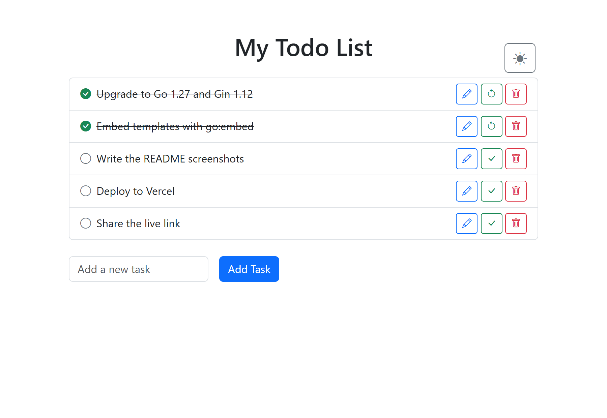
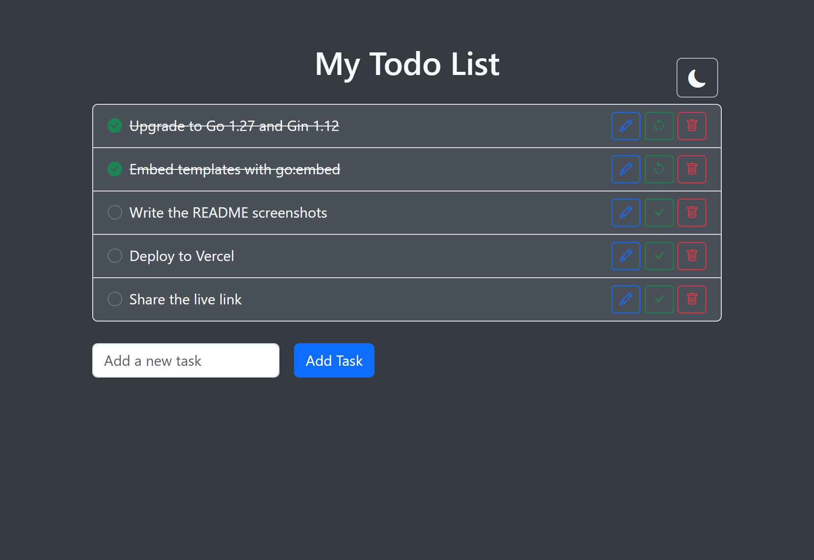
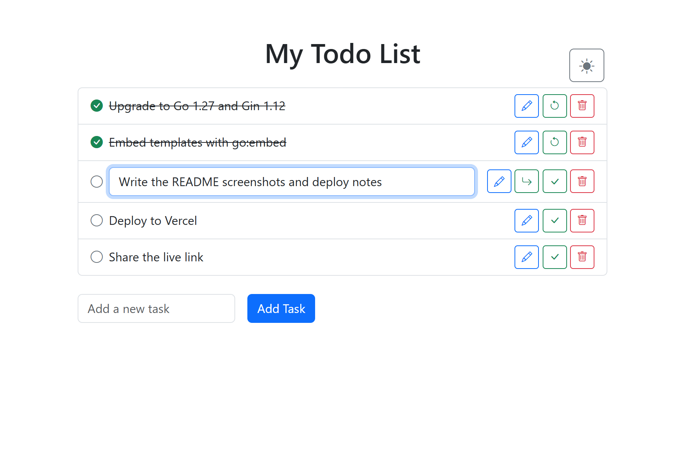

# Simple Todo List

This is a simple web-based Golang Todo List application using GIN that allows you to manage your tasks efficiently.



## Features

*   **Add Tasks:** Easily add new tasks to your todo list.
*   **Mark as Complete:** Mark tasks as complete, which will display them with a strikethrough.
*   **Delete Tasks:** Remove tasks from your list when they are no longer needed.
*   **Edit Tasks:** Modify the title of existing tasks.
*   **Dark/Light Theme:** Switch between a light and a dark theme for comfortable viewing.
*   **Validation:** The app has validation to prevent adding empty tasks.
*   **Press Enter to Commit:** In the edit task input field, you can press Enter to commit.
*   **No Server State:** Each visitor's tasks are kept in a cookie, so the server stores nothing and lists are private per browser.
*   **Single Binary:** Templates and static assets are embedded with `go:embed`, so the built binary runs from anywhere.

## Screenshots

| Dark theme | Editing a task |
| --- | --- |
|  |  |

## How It Works

New to Gin? [MAIN.md](MAIN.md) walks through how `main.go` serves the pages, renders the templates and talks to the JavaScript.

## How to Run

1.  **Install Go:** You need Go 1.27 or newer. Download it from the official Go website: [https://go.dev/](https://go.dev/)
2.  **Run the App:** Open your terminal and navigate to the project directory. Then, run the following command:
```
    go run .
```
3.  **Open in Browser:** Open your web browser and go to `http://localhost:8080` to access the application.

The listen address can be changed with `-addr` (for example `go run . -addr :9000`). If the `PORT` environment variable is set, it takes precedence.

To build a standalone binary:
```
    go build -o todolist .
```

That gives a binary of roughly 30 MB. For a much smaller one (about 15 MB), strip the debug info and leave out Gin's MessagePack support, which this app doesn't use:

```
    go build -tags nomsgpack -ldflags "-s -w" -o todolist .
```

`-s -w` removes the symbol table and debug info (you lose debugger support, but panics still print stack traces). `nomsgpack` is a Gin build tag that drops its MessagePack encoder.

## Deploying to Vercel

The project is set up for Vercel's Go runtime: `vercel.json` selects the `go` framework preset, which builds `main.go` and runs it as a server listening on `PORT`.

```
    npx vercel deploy
```

Or import the GitHub repository in the Vercel dashboard.

Tasks are stored in a cookie in each visitor's browser, not on the server. So every visitor gets their own private list, and it doesn't matter that Vercel may run several copies of the app at once. Lists are limited by the cookie size, to roughly 25 to 50 tasks depending on title length.

## How to Use

*   **Add a Task:** Enter the task title in the input field and click "Add Task". The app has validation to prevent adding empty tasks.
*   **Mark as Complete:** Click the check icon next to a task to mark it as complete. Click again to uncomplete it.
*   **Delete a Task:** Click the trashcan icon to delete a task.
*   **Edit a Task:**
    *   Click the pencil icon next to the task you want to edit.
    *   The task title will be replaced with an input field.
    *   Modify the text, and press Enter or click the save icon (a carriage return arrow) to save your changes.
*   **Toggle Theme:** Click the sun/moon icon in the top right corner to switch between light and dark themes.
